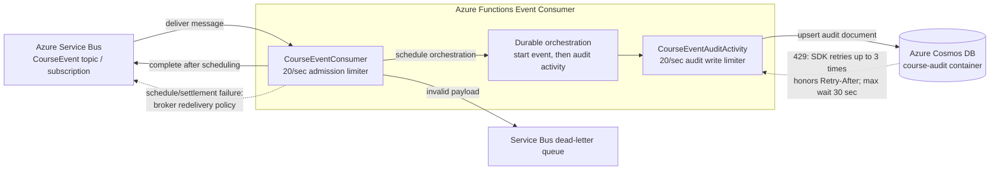

# Course event consumer

This Azure Functions isolated-worker app consumes `CourseEvent` messages, starts a
Durable Functions orchestration, and writes a course audit document to Cosmos DB.
This guide describes the current implementation and gives formulas for estimating
latency, throughput, retry behavior, and Cosmos DB capacity. The formulas are
planning estimates; benchmark the deployed workload before setting production
limits or budgets.

## Processing path and what success means



The two application rate limiters are process-local, so the Functions app must
remain at one host instance and one worker process to enforce a combined
20-per-second consumer cap. Cosmos SDK retries on 429 are additional database
attempts and are not rate-limited as separate permits. A Service Bus message is
completed once the orchestration is scheduled; audit-write failure happens
after that acknowledgement and does not automatically redeliver the original
message.

The main path is:

1. `CourseEventConsumer` receives a message from the `CourseEvent` topic's
   `CourseEventConsumer` subscription.
2. It deserializes the body, looks up an orchestration instance, schedules a
   `CourseEventOrchestrator`, and completes the Service Bus message.
3. The orchestration runs `CourseEventStartActivity`, then
   `CourseEventAuditActivity`.
4. The audit activity upserts one document to the `course-audit` Cosmos DB
   container, partitioned by `/courseId`.

**A completed Service Bus message means the orchestration was accepted, not that
the Cosmos audit write completed.** A failure in the later audit activity does
not make the original Service Bus message available again. Monitor both the
Service Bus intake and the Durable/audit activity path.

Invalid or null event bodies are dead-lettered by the consumer without scheduling
an orchestration. Failures while looking up or scheduling an orchestration, or
while settling the Service Bus message, are rethrown; the message has not been
successfully completed and can be delivered again.

The audit operation is an upsert using the event ID as the document ID and the
course ID as its partition key. Reprocessing the same event therefore updates
the same item rather than creating a second item with a different ID. The
orchestration lookup suppresses duplicates while an instance is active; completed,
failed, and terminated instances are considered stale and can be purged and
started again. Consequently, the upsert is also important for safe replay.

## Consumer rate and concurrency limits

The consumer applies a configurable token-bucket limiter at two points:

- Before handling each Service Bus delivery.
- Immediately before each `course-audit` Cosmos upsert.

The default is **20 permits per second at each point**, with a bucket size of
one and permits spaced 50 ms apart. `CourseEventRateLimiting:MaxOperationsPerSecond`
can lower the cap from 20; startup validation rejects values above 20. This
keeps an ingress burst from creating an unlimited Durable backlog and separately
caps logical audit upsert starts during normal processing or recovery. Each
limiter waits for its next permit rather than rejecting an event just because
the configured rate has been reached. Configure it with the Function App
setting `CourseEventRateLimiting__MaxOperationsPerSecond=20` (or a lower value);
the code default is 20 when the setting is absent.

These limiters are in-process. Configure the Azure Functions app's deployment
scale-out maximum to **one host instance** for this app or the effective cap is
multiplied by the number of instances. Keep `FUNCTIONS_WORKER_PROCESS_COUNT=1`
as well: each worker process has its own limiter. `host.json` has no
hosting-plan-neutral maximum-instance setting, so enforce and verify the
instance maximum in the Function App's hosting/deployment configuration. Do
not run multiple active deployments or slots against the same consumer
subscription unless the combined limit is recalculated.

The cap covers this app's message handling and course-audit upserts only. It
does not govern other services or operations sharing the Cosmos database. Also,
Cosmos DB throughput is measured in **RU/s**, not uniform requests/second. A
20-upsert/second cap is safe only if measured upsert RU charge and other shared
traffic fit the provisioned RU/s. Cosmos will still return 429 when the shared
RU budget is exceeded; use container/database throughput configuration and
monitor throttling independently.

The remaining values below come from this project's [host.json](host.json):

| Setting | Current value | Scope and implication |
| --- | ---: | --- |
| Service Bus `maxConcurrentCalls` | 20 | At most 20 concurrent trigger callbacks per host instance; the rate limiter still caps delivery handling at 20 permits/second. |
| Durable `maxConcurrentActivityFunctions` | 32 | At most 32 concurrent Durable activity executions per host instance. The audit write happens in an activity. |
| Durable `maxConcurrentOrchestratorFunctions` | 4 | At most four concurrent orchestrator executions per host instance. |
| Function timeout | 5 minutes | Maximum configured function execution duration; it is not a retry delay or a promise that a message completes within five minutes. |
| Service Bus prefetch | Not configured here | Do not assume a larger local prefetch setting; check the deployed extension and entity configuration. |

Concurrency limits bound in-flight work, not requests per second; the rate
limiters enforce the per-process request pacing. With `N` active host instances,
the nominal aggregate limiter rate is at most `N * 20` permits/second. The
configured one-instance deployment cap is therefore required to keep the
consumer at or below 20 permits/second. Durable and plan limits can lower the
actual completion rate.

## Latency

For one event, end-to-end time to a stored audit can be decomposed as:

```text
T_audit =
    T_service_bus_queue
  + T_consumer_callback
  + T_durable_queue_and_orchestration
  + T_start_activity
  + T_audit_activity_queue
  + T_cosmos_upsert
```

`T_consumer_callback` includes deserialization, the Durable instance lookup,
orchestration scheduling, and Service Bus message completion. It does **not**
include waiting for the orchestration or the audit write. Under backlog or
retry, queue and wait times can dominate function execution time.

Useful measurements:

- The consumer records `course.event_consumer.message.duration` around the
  trigger callback. This is not end-to-end audit latency.
- Function and Durable activity durations are recorded as
  `course.event_consumer.function.duration` and
  `course.event_consumer.activity.duration`. The audit activity duration includes
  the repository upsert call and any Cosmos SDK wait/retry time.
- Cosmos repository telemetry records request charge (RU) and operation
  duration for the upsert. Compare p50/p95/p99, not only averages.
- Track Service Bus enqueue-to-start age or active-message age, Durable
  orchestration age/status, audit activity duration, Cosmos 429 responses, and
  RU consumption together. The consumer callback histogram alone cannot reveal
  a stalled audit pipeline.

For a stable admitted rate `lambda` messages/second, Little's Law gives a useful
backlog estimate:

```text
in_flight_or_queued_messages ~= lambda * T_audit_seconds
```

For example, at 20 events/second and 10 seconds from enqueue to audit completion,
expect roughly 200 events in the combined in-flight/queued pipeline at steady
state. This is an estimate, not a queue limit.

## Throughput and backlog calculations

Let:

- `N` = active consumer host instances.
- `C_sb` = Service Bus callback concurrency per instance (currently 20).
- `T_sb` = average or measured p95 callback service time in seconds.
- `C_act` = activity concurrency per instance (currently 32).
- `T_act` = average or measured p95 audit activity execution time in seconds.
- `C_orch` = orchestrator concurrency per instance (currently 4).
- `T_orch` = measured active orchestrator execution time in seconds, excluding
  time waiting for activities.
- `q` = measured Cosmos RU charge for one audit upsert.
- `R` = available Cosmos RU/s for this workload after other container/database
  traffic is accounted for.

First-order capacity estimates, before applying the configured 20/second
consumer caps, are:

```text
Service Bus intake capacity ~= N * C_sb / T_sb                 messages/second
Audit activity capacity    ~= N * C_act / T_act                messages/second
Orchestrator capacity      ~= N * C_orch / T_orch              messages/second
Cosmos write capacity      ~= R / q                            messages/second
```

The actual admitted message rate and audit-upsert rate are each also capped by
`CourseEventRateLimiting:MaxOperationsPerSecond` per active host instance. The
pipeline's sustainable completion rate is bounded by its slowest stage:

```text
lambda_sustainable <= min(
    Service Bus intake capacity,
    Audit activity capacity,
    Orchestrator capacity,
    Cosmos write capacity,
    any plan, broker, or task-hub limit)
```

These estimates assume one successful audit upsert per event and no retries.
Use measured durations under representative load: p95 is useful for conservative
planning, but use a load test to find the actual saturation point. If failures
or retries occur, the same input event consumes more compute and can issue more
database operations.

For an incoming rate `lambda_in` and an observed completion rate `lambda_out`,
the approximate backlog change over `t` seconds is:

```text
backlog_change ~= (lambda_in - lambda_out) * t
```

When `lambda_in > lambda_out`, backlog grows. When the input stops and the
consumer has spare capacity, approximate drain time for `Q` queued events as:

```text
drain_time_seconds ~= Q / (lambda_out - lambda_in)
```

This drain formula only applies when completion rate exceeds ongoing arrivals.
Include time for scale-out and account for retries, throttling, and noisy
neighbors before using it for recovery objectives.

### Worked example (illustrative, not measured)

Suppose a deployed load test measured `T_sb = 0.20 s`, `T_act = 0.50 s`, and
`q = 8 RU` per audit upsert, with one host and `R = 400 RU/s` available to this
consumer. The rough stage estimates before the rate cap are:

```text
Intake:          1 * 20 / 0.20 = 100 messages/second
Audit activities:1 * 32 / 0.50 = 64 messages/second
Cosmos:          400 / 8 = 50 messages/second
Pipeline bound:  min(100, 64, 50) = 50 messages/second
Configured cap:  min(50, 20) = 20 messages/second
```

The rate limiter is the first constraint in this example. These sample values
are placeholders; Cosmos RU charge varies with document size, indexing,
existing-item versus new-item writes, and workload shape. Do not use the sample
to configure a real container.

## Retry and waiting behavior

### Service Bus delivery

The trigger sets `AutoCompleteMessages = false` and explicitly completes a
message after scheduling the orchestration. Invalid payloads are explicitly
dead-lettered. For other trigger-path exceptions, the function throws; the
message is not successfully completed and can be redelivered by Service Bus.

Redelivery timing is not a fixed five-second application delay. A message can be
made available after an abandon, or after its lock expires if the lock is lost;
the exact timing depends on settlement, lock duration/renewal, and broker
behavior. Each unsuccessful delivery contributes to the entity's delivery
count. When the configured `MaxDeliveryCount` is exceeded, Service Bus moves the
message to its dead-letter queue. Check the deployed subscription/entity
configuration for `LockDuration` and `MaxDeliveryCount`; they are not set by
this consumer's `host.json`.

The root `retry` block was removed from `host.json`: it does not configure
Service Bus delivery or Durable activity retries. Azure Functions documents
Service Bus retry behavior as extension/broker behavior, not as one of the
generic runtime retry policies. Use the actual Service Bus extension behavior
and the entity's delivery count/dead-letter settings to understand redelivery;
verify them in the deployed environment. See Microsoft's [Azure Functions
error handling and retry guidance](https://learn.microsoft.com/en-us/azure/azure-functions/functions-bindings-error-pages?tabs=isolated-process#retry-policies).

The shared Service Bus client registration also configures exponential SDK
retries (`MaxRetries = 3`, 1-second initial delay, 10-second maximum delay, and
10-second try timeout). These options apply to operations made through that
registered `ServiceBusClient` (for example, the publisher); they should not be
assumed to configure the Functions trigger receiver.

### Durable orchestration and Cosmos write

The orchestrator calls `CourseEventStartActivity` and then
`CourseEventAuditActivity` without a `CallActivityWithRetryAsync` /
`RetryOptions` policy. There is therefore no application-defined retry count or
delay between attempts for a failed audit activity. An activity failure can
fail the orchestration; the original Service Bus message has already been
completed. Durable runtime recovery/redelivery after worker or infrastructure
failure is separate from an explicit retry policy and can result in activity
execution more than once.

The Cosmos client sets `MaxRetryAttemptsOnRateLimitedRequests = 3`. The Cosmos
SDK retries 429 responses internally, respecting the server's retry-after delay,
for up to three retries after the initial attempt (four attempts total) subject
to the configured maximum total retry wait. This SDK retry is the Cosmos
repository's 429 resilience; the general resilience extension currently handles
HTTP operations and is not wired to Cosmos exceptions. If the SDK exhausts its
retries, the audit activity fails and the orchestration can fail. There is no
additional Durable activity retry policy; the already-completed Service Bus
message is not automatically redelivered for that audit failure. Alert on
failed orchestrations and define an operator replay/recovery path.

The audit limiter paces logical upsert calls. Cosmos SDK-internal 429 retries
are additional wire requests and do not acquire a new application limiter
permit. Thus the configured 20/second cap is not a strict cap on every network
attempt when retries occur; measure retry rates and RU/s, and lower the
application rate to leave room for retries and other callers.

The dead-letter handler stores dead-letter details in the configured DQL
message store (Azure Table Storage in the shared messaging registration); that
path is separate from the course audit container and should not be counted as
an audit-container RU write.

## Cosmos DB throughput and cost sizing

The audit container is named `course-audit` with partition key `/courseId`.
`CourseAuditRepository` performs one Cosmos `UpsertItemAsync` for each audit
activity that reaches the repository. This consumer does not create the
database/container or configure its throughput: the `CosmosClient` selects the
configured database, and infrastructure must provision the `course-audit`
container and its throughput mode.

For a measured peak event rate `lambda_peak` and measured average upsert charge
`q` RU:

```text
audit_RU_per_second ~= lambda_peak * q
planned_RU_per_second ~= audit_RU_per_second * headroom_factor
```

Use the **sum** of all workloads that share the database or container, including
reads, queries, other writers, and replay/backfill traffic. The headroom factor
is a deliberate safety margin based on burstiness and SLOs, not a universal
constant. A 20-upsert/second application cap does not ensure 20 total
database-requests/second when other callers exist, and it does not ensure that
the total RU/s fits the container's throughput. SDK retries after 429 add
attempts to telemetry and latency; throttled requests should be included when
analyzing request counts and retry rates.

With autoscale throughput, configure the maximum RU/s to cover the expected peak
aggregate RU demand with appropriate headroom. Cosmos DB scales within that
range; autoscale reduces the cost of idle periods compared with holding peak
provisioned throughput, but has a minimum billing floor and is billed based on
the highest scaled throughput during each billing interval. The floor and
regional price depend on the throughput setting and current Azure pricing.
Compare the current region's pricing and the cost of the autoscale maximum
against provisioned throughput before choosing. Autoscale is not a substitute
for setting a sensible maximum or testing peak load.

The `/courseId` partition key means one very active course can be a hot logical
partition even when aggregate container RU/s appears sufficient. Check normalized
RU consumption/throttling by partition as well as total RU utilization. If many
audit documents are for one course, benchmark that distribution specifically.

Illustrative estimate only: if a load test measures 8 RU per upsert and expects
20 events/second at peak, the audit write load alone is approximately
`20 * 8 = 160 RU/s`, before other database traffic and safety margin. Use the
actual recorded request charge and set the autoscale maximum based on the
aggregate expected peak, not this example.

## How to size and validate a deployment

1. **Measure the real write.** Load representative event payloads and record
   Cosmos upsert request charge, latency, throttling, and document size. Measure
   both new-item and existing-item upserts if both are expected.
2. **Measure the pipeline by stage.** Capture Service Bus enqueue-to-start age,
   callback duration, Durable orchestration/activity queue age and duration, and
   audit completion latency. Record the active host instance count and each
   stage's completion rate.
3. **Run a stepped load test.** Increase arrival rate in controlled steps,
   including burst and sustained periods. Watch backlog slope, p95/p99 latency,
   Service Bus delivery count/DLQ, Durable failures, Cosmos RU consumption and
   429s, and autoscale throughput.
4. **Find the first constrained stage.** Compare observed rates with the
   throughput estimates above. If Cosmos throttles, validate per-partition load
   and RU charge before raising the max. If intake or activities saturate, check
   scale-out/plan limits and task-hub capacity rather than increasing Cosmos
   throughput alone.
5. **Test recovery and replay.** Induce a bounded transient failure and verify
   actual broker redelivery timing, delivery count, dead-letter outcome, Durable
   failure handling, and idempotent audit upsert behavior. Do not infer these
   values from local configuration alone.
6. **Set and review the cost guardrail.** Provision the container's throughput
   in infrastructure configuration, select autoscale or provisioned throughput
   based on measured demand, set a maximum and alert thresholds, and review
   actual RU/s and spend after deployment.
7. **Verify enforcement in deployment.** Set the Function App's maximum scale
   to one instance using the setting supported by its hosting plan, confirm
   only one active deployment/slot consumes this subscription, and load-test
   that no more than 20 consumer admissions or course-audit upserts start in
   any second. The in-process limiter is not a distributed/global limiter.

## Relevant implementation

- [Service Bus and Durable host settings](host.json)
- [Service Bus trigger and orchestration scheduling](Consumers/Courses/CourseEventConsumer.cs)
- [Durable orchestration sequence](Consumers/Courses/CourseEventOrchestrator.cs)
- [Cosmos audit write](Consumers/Courses/CourseEventAuditActivity.cs)
- [Audit container and partition-key definition](../CourseLibrary.Course.Persistence/Data/Configurations/CourseAuditEntryConfiguration.cs)
- [Cosmos repository upsert](../CourseLibrary.Platform.Persistence.CosmosDB/Repositories/CosmosRepositoryBase.cs)
- [Cosmos client and repository registration](../CourseLibrary.Course.Persistence/CosmosRepositoryExtensions.cs)
