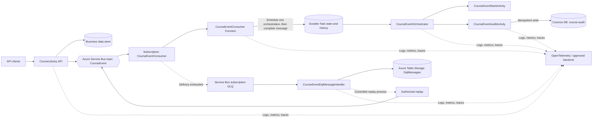

# CourseLibrary Event Consumer Project
## Final High-Level Solution Architecture and Requirements

**Document status:** Final requirements baseline; production values remain subject to validation where explicitly marked  
**System:** CourseLibrary asynchronous course-audit event processing  
**Primary technologies:** .NET isolated Azure Functions, Azure Service Bus, Durable Functions, Azure Cosmos DB, Azure Storage, OpenTelemetry, Microsoft.Extensions.Compliance  
**Date:** 18 October 2026

---

## 1. Purpose

This document defines the requirements and target architecture for publishing CourseLibrary business events and persisting audit records asynchronously. It consolidates the agreed requirements for throughput, concurrency, event handling, Cosmos DB protection, retries, dead-letter handling, retention, tracing, redaction, operations, and acceptance.

The design keeps audit persistence outside the synchronous API request path. The API publishes an event to Azure Service Bus. A Service Bus-triggered Azure Function validates the message and schedules one Durable Functions orchestration for that event. The orchestration executes a single audit-write activity. The activity writes an idempotent audit record to a dedicated Cosmos DB container.

**The processing flow must not fan out into multiple audit activities.** One event results in one orchestration and one logical audit-write operation. This reduces avoidable parallel work, but it does not by itself impose a global write limit: many independent event orchestrations can still execute concurrently, and Function scale-out multiplies per-host concurrency.

The architecture uses at-least-once delivery with idempotent persistence. It does not claim end-to-end exactly-once execution.

## 2. Agreed requirements and capacity targets

| Area | Requirement / target | Notes |
|---|---|---|
| API traffic | 10,000 requests per 10 seconds (1,000 requests/second average) | Load-test target, not a demonstrated production result |
| Event consumer | Up to 2,000 messages per 10 seconds (200 messages/second) | Must be validated against actual event production rate and Cosmos RU consumption |
| Audit storage | Separate Cosmos DB audit container | Container name: `course-audit` |
| Audit partition key | `/courseId` | Validate partition distribution and hot-partition behavior |
| Initial Cosmos capacity estimate | Approximately 1,000 RU/second | Starting estimate only; not a proven capacity commitment |
| Message processing | Service Bus topic/subscription and .NET isolated Functions | Subscription: `CourseEventConsumer` |
| Durable processing | One event per orchestration; no fan-out | One audit-write activity per event |
| Delivery semantics | At least once | Duplicate delivery and replay must be safe |
| Service Bus settlement | Manual settlement | Do not complete a message until Durable scheduling has been accepted durably |
| Sessions | Enabled where required by the current Service Bus configuration | Ordering applies to messages in the same session; it does not serialize later Durable activity execution |
| Active-message retention | Requested 15 days | Confirm selected Service Bus tier/entity limits before implementation |
| DLQ handling | Capture operational metadata in Azure Table Storage | Preserve the original DLQ message until metadata storage succeeds |
| DLQ retention | Requested 30 days | Service Bus DLQ messages do not automatically expire after 30 days in the same way as active messages; implement an explicit archive/cleanup policy |
| Observability | OpenTelemetry logs, metrics, and traces | W3C trace context across the asynchronous boundary |
| Sensitive-data protection | Classification-aware redaction | Use Microsoft.Extensions.Compliance; do not log raw event payloads or secrets |

### 2.1 Capacity mismatch that must be resolved

The targets are not automatically compatible:

- The API target is 1,000 requests/second.
- The consumer target is 200 events/second.
- If every API request produces an event, events arrive at a higher rate than the stated consumer target. The backlog will grow during that traffic pattern.
- At 200 audit writes/second, 1,000 RU/second allows only 5 RU per write before accounting for indexing, retries, reads, other operations, and a safety margin.

The team must confirm what proportion of API requests emit audit events, measure actual RU consumption per audit write, and load-test sustained throughput. Do not promise 200 audit writes/second from a 1,000 RU/second container without measurements.

## 3. Scope

### 3.1 In scope

- Course business events published by the CourseLibrary API.
- Azure Service Bus topic/subscription delivery.
- Durable Functions orchestration and activity execution.
- Idempotent audit persistence in Cosmos DB.
- Concurrency limits, backpressure, retry policy, and recovery.
- Service Bus dead-letter processing and Azure Table metadata storage.
- Event correlation and distributed tracing.
- Structured logging, metrics, alerts, redaction, and operational runbooks.
- Configuration and deployment requirements for the components above.

### 3.2 Out of scope

- Implementation of the API gateway or identity provider.
- A user-facing audit administration interface.
- A general-purpose event-streaming platform.
- Analytics, reporting, or business intelligence workloads.

## 4. High-level architecture



The Durable Task state store contains orchestration state and history. It is not the audit system of record. The `course-audit` Cosmos DB container is the system of record for successfully persisted audit records. Azure Table Storage stores DLQ operational metadata; it does not replace the original Service Bus DLQ message.

## 5. Component responsibilities

| Component | Responsibility |
|---|---|
| CourseLibrary API | Performs the business operation and publishes a versioned event with a stable event identifier and trace context |
| `CourseEvent` topic | Distributes published events to configured subscriptions |
| `CourseEventConsumer` subscription | Delivers events to the consumer and retains messages that exceed delivery handling limits in its DLQ |
| `CourseEventConsumer` Function | Validates the message, extracts trace context, creates a deterministic orchestration instance ID, schedules the orchestration, and completes the Service Bus message only after scheduling is accepted |
| `CourseEventOrchestrator` | Coordinates the event processing flow deterministically; does not perform direct network or database I/O |
| `CourseEventStartActivity` | Establishes the intended activity/trace boundary for the event processing workflow |
| `CourseEventAuditActivity` | Calls the audit persistence abstraction, applies the approved write-admission control, and performs the idempotent write |
| `ICourseAuditRepository` | Application-facing abstraction for audit persistence |
| `CourseAuditEntry` | Audit record model stored in the dedicated audit container |
| Cosmos DB `course-audit` | Stores persisted audit records, partitioned by `/courseId` |
| `CourseEventDqlMessageHandler` | Captures DLQ metadata and completes the original DLQ message only after the metadata operation succeeds |
| `IDqlMessageStore` | Abstraction for storing DLQ operational metadata |
| Azure Table Storage `DqlMessages` | Stores operational DLQ metadata for investigation and controlled replay |
| OpenTelemetry pipeline | Correlates producer, trigger, orchestration, activity, Cosmos write, and failure handling without exporting sensitive payloads |

## 6. Event lifecycle and settlement

1. A client calls the CourseLibrary API.
2. The API performs the business operation according to its existing API contract.
3. The API publishes a versioned event to the `CourseEvent` topic. The event has a stable event ID and carries W3C trace context where available.
4. The `CourseEventConsumer` subscription delivers the message to the Function using manual settlement.
5. The Function validates the message and derives a deterministic orchestration instance ID from the stable event/message identity.
6. The Function schedules exactly one `CourseEventOrchestrator` instance for that event.
7. Only after Durable Functions confirms the scheduling handoff has been accepted durably does the Function complete the Service Bus message.
8. The orchestrator invokes `CourseEventStartActivity` and one `CourseEventAuditActivity`. It must not fan out into multiple audit activities.
9. The audit activity writes the audit record to Cosmos DB through `ICourseAuditRepository`.
10. Duplicate execution or replay must not create duplicate logical audit records or replace an immutable record with different content.
11. Failures after the Service Bus message has been completed are handled by Durable retry and explicit failed-orchestration recovery. They do not automatically return the completed Service Bus message to the DLQ.

**Important settlement boundary:** completing the Service Bus message means Durable scheduling was accepted. It does not mean the audit record has been written. This distinction must be visible in monitoring and operational recovery procedures.

If orchestration scheduling fails, the trigger must fail without completing the Service Bus message. If the audit activity later fails permanently, the system needs a documented way to identify and recover the failed orchestration because the original Service Bus message has already been completed.

## 7. Event contract and idempotency

The actual event contract must follow the existing CourseLibrary event model and serializer. The following fields describe the logical requirements, not a mandate to replace the current type.

| Field / concept | Requirement |
|---|---|
| Event ID | Stable unique identifier across retries and replay |
| Event type | Identifies the business event type |
| Schema version | Allows compatible event evolution |
| Occurrence time | Timestamp of the business event, not consumer processing time |
| Course ID | Stable course identity and audit partition value |
| Actor identity | Include only the approved actor identifier required for audit |
| Correlation ID | Cross-component correlation; not an idempotency key |
| Trace context | W3C `traceparent` and optional `tracestate` / approved baggage |
| Payload | Minimum data needed for the audit use case; avoid secrets and unnecessary personal data |

### 7.1 Idempotency requirements

- Use a stable event ID as the logical identity of the audit record.
- Derive the Durable instance ID deterministically from the stable event/message identity, within the platform's instance-ID constraints.
- A repeated schedule attempt must have a defined outcome and must not silently create an unrelated orchestration for the same event.
- The audit write must use create/conditional-write semantics or an equivalent duplicate-safe design.
- Do not rely on an unconditional upsert if it can replace an existing audit record with different content.
- Define how a duplicate with the same event ID but different payload is detected, reported, and investigated.
- Retain enough event identity and status to reconcile a failed orchestration with the original event.
- Trace IDs, correlation IDs, timestamps, and random retry IDs must not be used as substitutes for the stable event ID.

## 8. Producer consistency

Publishing an event after a business database commit creates a dual-write gap: the business operation can succeed while event publication fails.

For audit events that cannot be discarded, prefer a transactional outbox where it is feasible within the business data store's transaction boundary. A separate dispatcher publishes pending outbox entries and records successful publication. If direct publication is retained, document and accept the residual event-loss risk and provide bounded retries and explicit failure reporting.

A Cosmos DB transactional batch cannot atomically commit arbitrary writes across separate containers. If the business data and outbox use Cosmos DB, the selected design must respect the supported container and logical-partition transaction boundary. The outbox is a consistency control, not an assumption that all cross-service writes become atomic.

## 9. Concurrency, ordering, and database protection

### 9.1 Core requirement

Concurrency must protect Cosmos DB from excess load. Per-host settings alone are insufficient because Azure Functions can scale out. Aggregate write pressure must be controlled across all active Function instances.

The target processing shape is:

- One event per orchestration.
- No fan-out.
- One logical audit-write activity per event.
- Low initial per-host concurrency.
- Bounded scale-out.
- A global/distributed write-admission control when a strict aggregate Cosmos RU budget is required.

### 9.2 Initial per-host configuration baseline

Use the following as a conservative starting point, subject to the exact installed Azure Functions Service Bus and Durable extension versions and the selected hosting plan. Verify the property names and session behavior against those versions before deployment.

```json
{
  "version": "2.0",
  "extensions": {
    "serviceBus": {
      "prefetchCount": 0,
      "maxConcurrentCalls": 1,
      "maxConcurrentSessions": 1,
      "maxConcurrentCallsPerSession": 1,
      "maxAutoLockRenewalDuration": "00:05:00",
      "autoCompleteMessages": false
    },
    "durableTask": {
      "maxConcurrentActivityFunctions": 1,
      "maxConcurrentOrchestratorFunctions": 1
    }
  }
}
```

Notes:

- The session-specific properties apply only when the selected Service Bus trigger binding and extension version support them and sessions are enabled on the entity.
- `maxConcurrentCalls` and the session-specific settings must be checked for their exact meaning in the installed extension version; do not assume every setting independently caps all session-trigger execution.
- Durable concurrency values are per worker/host instance. They are not global caps.
- These values intentionally prioritize protecting the audit database over maximum throughput. Raise them only after representative load tests and RU measurements.
- Keep dynamic concurrency disabled for the initial baseline if predictable, fixed local limits are required. Dynamic concurrency is not a strict global Cosmos RU budget.
- Configure and verify the maximum Function instance count for the selected hosting plan.

### 9.3 Sessions and ordering

Service Bus sessions provide ordered handling for messages that share a session ID, subject to the service's session semantics. Multiple session IDs can be processed concurrently.

The current Function flow completes the Service Bus message after Durable scheduling. Therefore, serial delivery of messages does **not** guarantee serial execution of their later Durable activities. A session lock does not remain held while the orchestration later writes to Cosmos DB.

If strict global sequential persistence is required, the design must serialize the actual persistence operation, not merely the scheduling trigger. This would reduce throughput and must be an explicit business requirement. The default design here does not claim strict global ordering of audit writes.

### 9.4 Global admission control

A per-process semaphore, token bucket, or limiter is multiplied when Functions scale out. It cannot enforce a strict global database budget on its own.

Where the Cosmos RU ceiling must be strictly enforced, implement a shared/distributed admission-control mechanism at the audit-write boundary:

- A distributed rate budget controls the number of writes admitted over time.
- A distributed semaphore controls the number of writes in flight.
- These controls solve different problems and should not be treated as interchangeable.
- Set the budget from measured RU/write, available RU/s, other workloads, retry overhead, and an approved safety margin.
- Handle Cosmos throttling (HTTP 429) with the SDK's retry guidance and avoid multiplying retries at every layer.
- When capacity is unavailable, apply backpressure and let durable work wait/retry rather than allowing unbounded concurrent writes.
- Ensure the mechanism remains effective across scale-out and is observable.

Do not add a global limiter unless a strict shared RU budget is a requirement; if it is required, the limiter must be truly distributed. A local-only limiter is not sufficient.

### 9.5 Throughput validation

Load tests must cover:
- Normal event rate and peak event rate.
- Cosmos throttling and temporary outage.
- Function scale-out and scale-in.
- Backlog accumulation and controlled backlog drain.
- Partition-key skew and hot partitions.
- Duplicate deliveries, duplicate orchestration scheduling, and activity retries.
- Durable storage load and orchestration history growth.
- Recovery time after the downstream database becomes healthy.

Measure events/second, successful audit writes/second, end-to-end audit latency, oldest message age, queue/subscription depth, failed orchestration count, Cosmos RU consumption, 429 rate, retry count, and per-partition distribution.

## 10. Retry, failure, and recovery

Use bounded retries with exponential backoff and jitter for transient failures. Honor server-provided retry hints where supported. Avoid an uncontrolled retry storm across Service Bus redelivery, Durable activity retry, Cosmos SDK retry, and manual replay.

| Failure | Required behavior |
|---|---|
| Invalid event/schema | Reject or dead-letter with a safe reason code; do not log the raw payload |
| Temporary Service Bus failure | Let the trigger fail so normal Service Bus delivery retry can occur |
| Durable scheduling failure | Do not complete the Service Bus message |
| Duplicate scheduling/delivery | Resolve deterministically using stable event identity; avoid creating duplicate logical work |
| Cosmos DB throttling | Respect SDK retry guidance, apply write admission/backpressure, and emit throttling metrics |
| Cosmos DB unavailable | Retry within the configured budget; keep Durable failure visible and alert on age/count |
| Permanent audit activity failure | Mark/identify the orchestration as failed and use an explicit recovery or replay process |
| Function host recycle | Allow platform redelivery/replay behavior; idempotency prevents duplicate audit records |
| DLQ metadata storage failure | Do not complete the original DLQ message |
| Telemetry backend unavailable | Business processing should continue where exporter configuration permits; use bounded buffering and export-health monitoring |

Define the retry count, maximum elapsed time, poison-message behavior, and ownership of manual recovery in configuration and runbooks. Do not allow repeated manual replay to bypass idempotency.

## 11. Dead-letter handling and retention

### 11.1 Active messages

The requested active-message retention is 15 days. Validate the selected Service Bus tier and entity configuration limits before treating this as achievable. Do not silently configure a lower value while claiming the requirement is met.

### 11.2 Dead-letter messages

The requested DLQ retention is 30 days. Do not assume that Service Bus automatically deletes DLQ messages after 30 days. Define an explicit operational policy to inspect, archive if required, and remove eligible DLQ messages after the approved retention period.

### 11.3 DLQ metadata

`CourseEventDqlMessageHandler` must store operational metadata using `IDqlMessageStore` in the `DqlMessages` Azure Table Storage table before completing the original DLQ message.

Capture only what operations needs, such as:
- Original message ID and event ID when available.
- Event type and subscription/entity identity.
- Dead-letter reason and safe error description.
- Enqueue/dead-letter time and delivery count.
- Correlation/trace identifiers.
- Processing status, investigation ownership, and replay status.

Do not treat a base64 payload as protected storage. If a copy of the payload is necessary for a governed archive, apply data classification, access controls, encryption, retention, and deletion requirements explicitly. Avoid storing full payloads in Table Storage by default.

If metadata persistence fails, leave the original DLQ message uncompleted so the operation can be retried. Replay must be authorized, traceable, idempotent, and rate-limited. Preserve enough history to prevent repeated replay loops.

## 12. Audit data and Cosmos DB

- Use the dedicated `course-audit` container with partition key `/courseId`.
- Keep audit persistence behind `ICourseAuditRepository`.
- Keep audit record schema separate from the business aggregate schema.
- Define which fields are mandatory, optional, sensitive, or prohibited.
- Define whether audit records are immutable and how correction events are represented.
- Prefer create-only or conditional persistence to avoid accidental replacement of an existing audit record.
- Validate indexing policy and payload size against the audit query requirements.
- Monitor RU consumption, throttling, storage growth, partition distribution, write latency, and failed writes.
- Confirm whether throughput is provisioned or autoscale and establish an approved budget and safety margin.
- Treat 1,000 RU/s as an initial estimate, not a guarantee of 200 writes/second.

The audit container is separate from the business data container. Do not assume cross-container transactional consistency.

## 13. Observability, tracing, and redaction

### 13.1 Tracing

Propagate W3C `traceparent` and `tracestate` where present and permitted. Use baggage only for approved, low-risk metadata. Preserve the trace relationship across the API publisher, Service Bus message, trigger, Durable orchestration, activities, Cosmos write, and DLQ processing.

Use the existing CourseLibrary activity sources and metrics where appropriate. Avoid duplicate spans for the same logical operation and keep Durable orchestration replay behavior in mind when instrumenting orchestrators. Orchestrator code must remain deterministic and must not perform direct I/O.

### 13.2 Structured logs and metrics

Logs should describe state transitions and failures using stable event IDs, event types, orchestration IDs, correlation IDs, trace IDs, attempt counts, elapsed time, and safe error categories. Do not log access tokens, secrets, connection strings, or raw event payloads.

Required operational signals include:
- Published events and publish failures.
- Trigger deliveries and scheduling failures.
- Successful and failed orchestrations.
- Successful audit writes, duplicate detections, and write latency.
- Cosmos RU consumption and HTTP 429 responses.
- Retry counts and exhausted retry budgets.
- Active queue/subscription depth and oldest-message age.
- DLQ count, reason categories, metadata-write failures, and replay outcomes.
- Durable task storage health and orchestration backlog.
- OpenTelemetry exporter health.

Set alerts only after baselines are measured; thresholds must reflect the approved SLOs and operational response expectations.

### 13.3 Microsoft.Extensions.Compliance

Use classification-aware redaction through Microsoft.Extensions.Compliance for structured log data and any telemetry fields that may contain sensitive information. Redaction must be validated in the actual exported logs/traces, not only in local console output.

- Classify event fields and operational metadata.
- Redact or omit personal data not required for diagnostics.
- Never export secrets, access tokens, connection strings, or raw message bodies.
- Do not assume structured logging, base64 encoding, trace sampling, or a correlation ID provides data protection.
- Restrict telemetry and operational-store access with least privilege and an approved retention policy.

## 14. Security and configuration

- Use managed identities where supported for Azure resources.
- Apply least-privilege RBAC to Service Bus, Cosmos DB, Storage, and telemetry.
- Store secrets in Key Vault or approved managed configuration; do not commit production secrets to source control.
- Separate development, test, and production resources and identities.
- Apply approved network restrictions and private connectivity where required by the environment.
- Deploy topics, subscriptions, Cosmos containers and throughput, Storage tables, RBAC, diagnostics, and alerts through reviewed infrastructure as code.
- Validate event schema compatibility before deploying producer or consumer changes.
- Confirm the Durable Task storage provider, Function hosting plan, scale limits, and storage configuration before production.

## 15. Configuration baseline

The following table records the agreed direction. Values marked “validate” must be confirmed in the target Azure tier, extension version, and load test.

| Area | Setting | Baseline / requirement |
|---|---|---|
| API | Capacity | 10,000 requests per 10 seconds; load-test |
| Event production | Event rate | Confirm the proportion of API requests that emit events |
| Service Bus | Topic | `CourseEvent` |
| Service Bus | Subscription | `CourseEventConsumer` |
| Service Bus | Message identity | Stable event ID |
| Service Bus | Sessions | Enabled where configured/required; confirm session ID and ordering requirement |
| Service Bus | Prefetch | `0` initially |
| Service Bus | Per-host concurrency | Start low; proposed values shown in Section 9.2 |
| Service Bus | Settlement | Manual Peek-Lock; complete only after Durable scheduling succeeds |
| Service Bus | Active TTL | Requested 15 days; validate tier/entity limits |
| Service Bus | Maximum delivery count | Choose and validate; a starting value of 10 may be load/failure tested |
| Durable Functions | Orchestration shape | One event, one orchestration, no fan-out |
| Durable Functions | Activity concurrency | Start at 1 per host; raise only after tests |
| Durable Functions | Orchestrator concurrency | Start at 1 per host; raise only after tests |
| Durable Functions | Global concurrency | Not enforced by `host.json`; use distributed admission control if strict aggregate cap is required |
| Cosmos DB | Audit container | `course-audit` |
| Cosmos DB | Partition key | `/courseId` |
| Cosmos DB | Initial throughput estimate | 1,000 RU/s; validate with actual RU/write |
| Cosmos DB | Persistence | Duplicate-safe, preferably create-only/conditional |
| DLQ | Metadata store | Azure Table Storage table `DqlMessages` |
| DLQ | Retention | Requested 30 days; implement explicit archive/cleanup |
| Observability | Trace context | W3C `traceparent` and `tracestate` where available |
| Observability | Backend | Azure Monitor / Application Insights / approved OTLP backend; confirm actual exporter registration |
| Compliance | Redaction | Microsoft.Extensions.Compliance, validated on exported telemetry |

## 16. Deployment and rollout

1. Confirm the event contract and which API operations publish events.
2. Confirm event arrival rate against the 200 messages/second consumer target.
3. Confirm Service Bus tier, sessions, active TTL, DLQ handling, quotas, and duplicate detection requirements.
4. Confirm the Functions hosting plan, extension versions, scale limits, and Durable Task storage provider.
5. Deploy the topic/subscription, audit container, Storage table, access policies, and telemetry through infrastructure as code.
6. Implement deterministic orchestration identity and duplicate-safe audit persistence.
7. Implement and test retry limits, failed-orchestration visibility, DLQ metadata handling, and controlled replay.
8. Configure conservative per-host concurrency and maximum scale-out.
9. If strict RU protection is required, verify the distributed admission control across multiple Function instances.
10. Run throughput, failure, recovery, scale-out, and redaction tests before production rollout.
11. Roll out gradually and monitor backlog age, audit latency, RU consumption, throttling, failures, and duplicate handling.
12. Adjust concurrency only from measured evidence and within the approved aggregate database budget.

## 17. Operational runbooks

### 17.1 Growing backlog

- Check incoming event rate, successful audit-write rate, and oldest message age.
- Check Cosmos RU consumption, throttling, partition skew, and activity failures.
- Verify the global write-admission control and Function scale-out limits.
- Do not increase scale-out blindly if the database is already at its approved RU budget.
- Increase capacity or adjust the consumer rate only after confirming the bottleneck and approved cost/capacity limits.

### 17.2 Cosmos DB throttling or outage

- Check 429 counts, RU consumption, latency, and Cosmos health.
- Ensure retries honor SDK/server guidance and are bounded.
- Confirm write admission is applying backpressure.
- Monitor failed Durable activities and the oldest pending event.
- After recovery, drain backlog at a controlled rate without exceeding the database budget.

### 17.3 Failed orchestration after trigger completion

- Identify the failed orchestration using stable event/orchestration identity.
- Inspect safe error metadata and activity retry history.
- Determine whether the audit record already exists before replay.
- Use the authorized recovery procedure; do not expect the completed Service Bus message to return automatically to the DLQ.
- Record replay ownership and outcome.

### 17.4 DLQ investigation

- Preserve the original DLQ message until metadata storage succeeds.
- Classify the failure reason and assign ownership.
- Correct the underlying cause before replay.
- Replay at a controlled rate with duplicate-safe persistence.
- Apply the approved 30-day archive/cleanup policy and retain an operational record of the action.

### 17.5 Telemetry redaction failure

- Stop or restrict export of the affected fields where possible.
- Confirm whether sensitive values were exported and follow the organization's incident process.
- Fix classification/redaction configuration and add a regression test against the actual exporter.
- Resume export only after validation.

## 18. Acceptance criteria

The architecture is ready for production approval when all of the following are met:

- [ ] The event contract, event-producing API operations, and schema-evolution policy are approved.
- [ ] The producer consistency approach is approved and its event-loss implications are documented.
- [ ] Load tests demonstrate the required API and consumer throughput or document an approved capacity adjustment.
- [ ] Event arrival rate and consumer drain rate are compatible, including backlog recovery.
- [ ] Actual RU/write, partition distribution, and safe Cosmos capacity are measured.
- [ ] Per-host concurrency and maximum scale-out are configured and verified for the selected plan.
- [ ] If a strict aggregate RU budget is required, distributed admission control is proven to work across multiple hosts.
- [ ] Each event schedules one orchestration and one logical audit-write activity; there is no audit fan-out.
- [ ] Duplicate delivery, duplicate scheduling, activity retry, and replay do not create duplicate logical audit records or overwrite immutable records.
- [ ] Service Bus settlement occurs only after Durable scheduling is accepted.
- [ ] Failed orchestrations after Service Bus completion are detectable and recoverable.
- [ ] Active-message retention and DLQ retention/archive behavior meet approved requirements within actual platform limits.
- [ ] DLQ metadata failure does not cause the original DLQ message to be discarded.
- [ ] OpenTelemetry correlates the event lifecycle and provides useful metrics without exposing payloads or secrets.
- [ ] Microsoft.Extensions.Compliance redaction is validated on exported telemetry.
- [ ] Access control, encryption, data classification, retention, and operational replay permissions are approved.
- [ ] Runbooks cover backlog, throttling/outage, failed orchestration, DLQ recovery, and telemetry redaction failures.

## 19. Known constraints and decisions that remain explicit

These are validation items, not hidden assumptions:

1. **Capacity:** 1,000 RU/s and 200 audit writes/second have not been proven compatible.
2. **Arrival rate:** the fraction of API requests that create events must be confirmed.
3. **Global concurrency:** `host.json` limits are per host. They do not enforce a global concurrency or RU cap.
4. **No fan-out:** one activity per orchestration reduces per-event parallelism but does not prevent independent orchestrations from running concurrently.
5. **Sessions:** sessions order delivery within a session, but the trigger's early completion does not serialize later Durable activities.
6. **Durable failures:** after the Service Bus message is completed, later activity failure requires Durable-state-based recovery.
7. **Retention:** 15-day active TTL and 30-day DLQ retention must be implemented according to actual Service Bus behavior and the selected tier; DLQ cleanup requires an explicit process.
8. **Producer dual write:** direct publication after a business commit can lose an event in a failure window. The chosen consistency mechanism must be approved.
9. **Cosmos writes:** unconditional upsert can replace an existing record; use a duplicate-safe persistence contract.
10. **Payload storage:** base64 encoding does not protect payload data.
11. **Telemetry:** exporter registration, backend retention, sampling, and redaction must be verified in the deployed environment.
12. **Durable storage:** the configured Durable Task provider and hosting-plan constraints must be verified.

## 20. Repository alignment

This document aligns with the current CourseLibrary implementation context:

- `CourseLibrary.Course.EventConsumer` is a .NET isolated Azure Functions application.
- `CourseEventConsumer` uses manual Service Bus settlement, creates a deterministic orchestration ID, schedules `CourseEventOrchestrator`, and then completes the message.
- `CourseEventOrchestrator` calls `CourseEventStartActivity` and `CourseEventAuditActivity`.
- `CourseEventAuditActivity` writes `CourseAuditEntry` through `ICourseAuditRepository`.
- The audit document configuration targets `course-audit` with `/courseId` partitioning.
- `CourseEventDqlMessageHandler` stores DLQ information through `IDqlMessageStore` before completing the DLQ message.
- The solution uses custom OpenTelemetry activity sources, trace-context propagation, and function metrics middleware.
- Microsoft.Extensions.Compliance redaction is a required part of the telemetry/data-protection design and must be validated in the exported output.

**Final operating rule:** protect the audit database first. Start with one event per orchestration, no fan-out, low per-host concurrency, and bounded scale-out. Increase throughput only after measuring event arrival rate, Cosmos RU/write, end-to-end latency, backlog behavior, and failure recovery.
