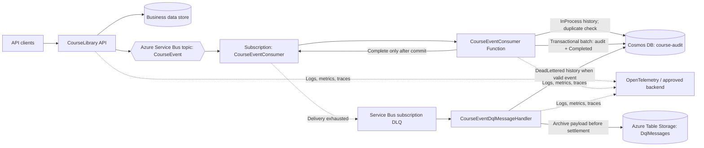

# CourseLibrary Event Consumer Project
## Final High-Level Solution Architecture and Requirements

**Document status:** Final requirements baseline; production values remain subject to validation where explicitly marked  
**System:** CourseLibrary asynchronous course-audit event processing  
**Primary technologies:** .NET isolated Azure Functions, Azure Service Bus, Azure Cosmos DB, Azure Storage, OpenTelemetry
**Date:** 18 October 2026

---

## 1. Purpose

This document defines the requirements and target architecture for publishing CourseLibrary business events and persisting audit records asynchronously. It consolidates the agreed requirements for throughput, concurrency, event handling, Cosmos DB protection, retries, dead-letter handling, retention, tracing, redaction, operations, and acceptance.

The API publishes events to Azure Service Bus. The Service Bus-triggered Function validates the event and schedules a Durable orchestration. A successful Function invocation is completed automatically by the Service Bus binding. Failures in the invocation are retried by Service Bus; later Durable orchestration failures do not redeliver the original Service Bus message.

Durable Functions own retries and failure handling after the Service Bus-triggered invocation completes. Service Bus retries apply only to failures before the invocation returns successfully.

The consumer provides at-least-once processing with duplicate-safe persistence. It does not claim end-to-end zero loss until the API's business-commit/publication dual-write gap is closed with a transactional outbox.

## 2. Agreed requirements and capacity targets

| Area | Requirement / target | Notes |
|---|---|---|
| API traffic | 10,000 requests in a 10-second burst, then 500 requests/second sustained | 100% of requests produce events; validate in load test |
| Event consumer | Proposed 600 completed events/second | 100% of requests emit; 10-second 1,000/s burst followed by 500/s sustained; validate p95 and measured RU/event |
| Audit storage | Separate Cosmos DB audit container | Container name: `course-audit` |
| Audit partition key | `/courseId` | Validate partition distribution and hot-partition behavior |
| Cosmos DB throughput | Not yet sized | The prior 4,286 RU/s estimate assumed one 5-RU write/event; it is invalid for the current read + status-create + transactional-batch path |
| Message processing | Service Bus topic/subscription and .NET isolated Functions | Subscription: `CourseEventConsumer` |
| Processing path | Durable handoff | One Service Bus message per invocation; audit processing continues in a Durable orchestration |
| Delivery semantics | At least once | Duplicate delivery and replay must be safe |
| Service Bus settlement | Automatic completion after successful Function invocation | Current invocation completes after scheduling its Durable orchestration, not after audit persistence |
| Service Bus lock renewal | 15 minutes maximum automatic renewal | Separate from the five-minute Function execution timeout |
| Subscription delivery limit | 6 deliveries | One initial delivery plus five redeliveries; configure on the Service Bus subscription, not in `host.json` |
| Sessions | Not enabled by the current Function trigger | No message-ordering guarantee |
| Active-message retention | Requested 15 days | Confirm selected Service Bus tier/entity limits before implementation |
| DLQ handling | Capture operational metadata in Azure Table Storage | Preserve the original DLQ message until metadata storage succeeds |
| DLQ retention | Requested 30 days | Service Bus DLQ messages do not automatically expire after 30 days in the same way as active messages; implement an explicit archive/cleanup policy |
| Observability | OpenTelemetry logs, metrics, and traces | W3C trace context across the asynchronous boundary |
| Sensitive-data protection | Classification-aware redaction | Use Microsoft.Extensions.Compliance; do not log raw event payloads or secrets |

### 2.1 Capacity mismatch that must be resolved

The targets are not automatically compatible:

- The API target is 1,000 requests/second.
- The agreed profile is a 10-second peak at 1,000 events/second followed by 500 events/second sustained.
- The original 200 events/second consumer target is below the sustained arrival rate. Its backlog would grow by 300/s (1.08 million/hour), so long-term latency is unbounded.
- A proposed 600 events/second capacity creates 4,000 queued events over the 10-second burst from an empty queue. At 500 arrivals/s afterward, the 100/s net drain clears that burst backlog in about 40 seconds, excluding handler overhead.
- The previous estimate of 4,286 RU/s assumed one 5-RU write/event. It must not be used for the new flow, which performs a duplicate-check read, an `InProcess` status create, and a transactional batch that creates the audit and `Completed` status. Measure RU/event for this entire path, including error cases and SDK retries.

### 2.2 Calculated planning envelope (provisional)

The following arithmetic makes the mismatch actionable; it is not a claim of measured production performance:

- A 10-second burst at 1,000/s produces 10,000 events. At 600 completions/s, 6,000 complete during the burst and approximately 4,000 remain queued.
- After the burst, 600 completions/s against 500 arrivals/s provides 100/s of net drain, clearing those 4,000 messages in about 40 seconds if there was no pre-existing backlog.
- Let `R` be the measured Cosmos RU charge per successfully persisted event for the complete path. At 500 events/s, a 30% reserve requires `500 × R / 0.70` configured RU/s. At the proposed 600 events/s recovery rate, it requires `600 × R / 0.70` configured RU/s. Do not substitute the old 5-RU/write assumption for `R`.

The end-to-end SLO is p95 publication-to-persistence under two minutes; no measured Function processing-time distribution is available. Throughput alone cannot establish p95/p99 latency. For concurrency sizing, Little's Law gives the following illustrative average in-flight callback counts:

| Average end-to-end handler time | In flight at 1,000 events/s burst | In flight at 600 events/s capacity | In flight at 500 events/s baseline |
|---:|---:|---:|---:|
| 100 ms | 100 | 60 | 50 |
| 200 ms | 200 | 120 | 100 |
| 250 ms | 250 | 150 | 125 |
| 500 ms | 500 | 300 | 250 |
| 1 second | 1,000 | 600 | 500 |

These values are planning examples, not measured capacity. Measure full handler duration, queue age, successful event rate, RU/event, and end-to-end latency under the full burst and baseline profile. Delayed processing is acceptable; messages remain in Service Bus or the DLQ until their durable writes succeed.

## 3. Scope

### 3.1 In scope

- Course business events published by the CourseLibrary API.
- Azure Service Bus topic/subscription delivery.
- Direct Service Bus processing and manual message settlement.
- Idempotent audit persistence in Cosmos DB.
- Concurrency limits, backpressure, retry policy, and recovery.
- Service Bus dead-letter processing and Azure Table metadata storage.
- Event correlation and distributed tracing.
- Structured logging, metrics, alerts, redaction, and operational runbooks.
- Configuration and deployment requirements for the components above.

### 3.2 Out of scope

- Implementation of the API gateway or identity provider.
- A user-facing audit administration interface.
- A general-purpose event-streaming platform.
- Analytics, reporting, or business intelligence workloads.

## 4. High-level architecture



The `course-audit` Cosmos DB container is the system of record for persisted audit records and append-only course processing history. Azure Table Storage archives the full DLQ payload and metadata before the original DLQ message is settled. Archival failure leaves that DLQ message available for retry.

## 5. Component responsibilities

| Component | Responsibility |
|---|---|
| CourseLibrary API | Performs the business operation and publishes a versioned event with a stable event identifier and trace context |
| `CourseEvent` topic | Distributes published events to configured subscriptions |
| `CourseEventConsumer` subscription | Delivers events to the consumer and retains messages that exceed delivery handling limits in its DLQ |
| `CourseEventConsumer` Function | Validates the message, schedules a Durable orchestration, and automatically completes the Service Bus message when the invocation returns successfully |
| `ICourseAuditRepository` | Creates append-only status entries, reads by event ID, writes audit plus terminal status transactionally, and pages course history |
| `CourseEventHistoryEntry` | Append-only status record with course/event/message IDs, attempt, timestamp, notes, and error type |
| `CourseAuditEntry` | Immutable audit record stored in the dedicated audit container |
| Cosmos DB `course-audit` | Stores persisted audit records, partitioned by `/courseId` |
| `CourseEventDqlMessageHandler` | Stores full DLQ payload in Table Storage; the binding automatically completes the DLQ message after successful archival |
| `IDqlMessageStore` | Abstraction for storing DLQ operational metadata |
| Azure Table Storage `DqlMessages` | Stores operational DLQ metadata for investigation and controlled replay |
| OpenTelemetry pipeline | Correlates producer, trigger, Cosmos writes, status transitions, and DLQ handling without exporting sensitive payloads |

## 6. Event lifecycle and settlement

1. A client calls the CourseLibrary API.
2. The API performs the business operation according to its existing API contract.
3. The API publishes a versioned event to the `CourseEvent` topic. The event has a stable event ID and carries W3C trace context where available.
4. The `CourseEventConsumer` subscription delivers the message to the Function with automatic completion enabled.
5. The Function validates the message, then schedules a Durable orchestration.
6. When scheduling succeeds and the Function returns, the Service Bus binding automatically completes the message. Exceptions during the Function invocation are propagated for Service Bus retry.
7. The Durable orchestration performs audit persistence after the original Service Bus message has been completed.
8. The subscription's configured `MaxDeliveryCount` controls retries for failures before the Function invocation returns; exhausted messages enter the subscription DLQ.
9. The DLQ handler archives the original payload and metadata to Table Storage; the binding automatically completes the DLQ message when archival succeeds. An archival exception leaves the message eligible for retry.
10. Messages that cannot be deserialized fail the invocation and follow the subscription's retry/dead-letter policy.

**Important settlement boundary:** Service Bus completion means only that the Function invocation returned successfully after orchestration scheduling. It does not confirm audit persistence. A later Durable orchestration failure is outside the Service Bus retry boundary.

The producer's direct API publish still has a dual-write gap with the business database. A transactional outbox is required before claiming end-to-end zero loss from business commit through audit persistence.

## 7. Event contract and idempotency

The actual event contract must follow the existing CourseLibrary event model and serializer. The following fields describe the logical requirements, not a mandate to replace the current type.

| Field / concept | Requirement |
|---|---|
| Event ID | Stable unique identifier across retries and replay |
| Event type | Identifies the business event type |
| Schema version | Allows compatible event evolution |
| Occurrence time | Timestamp of the business event, not consumer processing time |
| Course ID | Stable course identity and audit partition value |
| Actor identity | Include only the approved actor identifier required for audit |
| Correlation ID | Cross-component correlation; not an idempotency key |
| Trace context | W3C `traceparent` and optional `tracestate` / approved baggage |
| Payload | Minimum data needed for the audit use case; avoid secrets and unnecessary personal data |

### 7.1 Idempotency requirements

- Use a stable event ID as the logical identity of the audit record.
- Use the event ID as the immutable audit document ID within the course partition.
- Create, rather than upsert, the audit record and history entries. A conflict is treated as success only when the audit record for the same event already exists.
- The audit and `Completed` status must be written in one transactional batch. Service Bus redelivery after a successful Cosmos commit must not create a second audit record.
- Do not rely on an unconditional upsert if it can replace an existing audit record with different content.
- Define how a duplicate with the same event ID but different payload is detected, reported, and investigated.
- Retain enough event identity and append-only statuses to reconcile attempts and DLQ disposition with the original event.
- Trace IDs, correlation IDs, timestamps, and random retry IDs must not be used as substitutes for the stable event ID.

## 8. Producer consistency

Publishing an event after a business database commit creates a dual-write gap: the business operation can succeed while event publication fails.

Because audit events cannot be discarded, implement a transactional outbox within the business data store's transaction boundary before claiming end-to-end zero loss. A separate dispatcher publishes pending outbox entries and records successful publication. The current API publishes directly after a business commit, so an event can be lost in that producer-side failure window until the outbox exists.

A Cosmos DB transactional batch cannot atomically commit arbitrary writes across separate containers. If the business data and outbox use Cosmos DB, the selected design must respect the supported container and logical-partition transaction boundary. The outbox is a consistency control, not an assumption that all cross-service writes become atomic.

## 9. Concurrency, ordering, and database protection

### 9.1 Core requirement

Concurrency must protect Cosmos DB from excess load. Per-host settings alone are insufficient because Azure Functions can scale out. Aggregate write pressure must be controlled across all active Function instances.

The target processing shape is:

- One event per Service Bus function invocation.
- No Durable handoff for new events.
- One append-only `InProcess` record, then one atomic audit-plus-`Completed` write per successful event.
- Low initial per-host concurrency.
- Bounded scale-out.
- A global/distributed write-admission control when a strict aggregate Cosmos RU budget is required.

### 9.2 Initial per-host configuration baseline

The active Function project is `CourseLibrary.Course.EventConsumer`. Its current local rate limiter defaults to 20 message permits/second and 20 audit-write permits/second per worker process. Each successful event consumes two audit-write permits (initial status create and final transactional batch), plus a duplicate-check read; thus the local limiter caps a process at no more than 10 successfully completed events/second before accounting for other bottlenecks. `host.json` controls per-host callback concurrency, not aggregate throughput. The checked-in baseline below bounds local work and prevents prefetch from locking messages while waiting for Cosmos.

```json
{
  "version": "2.0",
  "extensions": {
    "serviceBus": {
      "prefetchCount": 0,
      "maxConcurrentCalls": 4,
      "maxAutoLockRenewalDuration": "00:15:00"
    },
    "durableTask": {
      "maxConcurrentActivityFunctions": 4,
      "maxConcurrentOrchestratorFunctions": 2
    }
  },
  "concurrency": {
    "dynamicConcurrencyEnabled": false
  }
}
```

Notes:

- The Service Bus trigger permits at most 4 concurrent callbacks per host. Its lock is automatically renewed for up to 15 minutes; the Function timeout remains five minutes. Long processing may still cause duplicate delivery; idempotency is mandatory.
- Durable activity/orchestrator limits remain only to allow previously scheduled workflows to drain. New messages do not schedule orchestrations.
- With four callbacks/host and two audit permits/event, reaching 600 completed events/second requires at least 60 single-process-equivalent workers based on the 20 permits/second local write limiter. This is a mathematical minimum, not a deployment recommendation; the actual Cosmos RU/event, Function duration, Flex scale response, retries, and database budget may require a lower rate or greater capacity.
- At 600 events/second, Little's Law gives 120 concurrent callbacks if measured mean handler time is 200 ms. Four callbacks/host would therefore require 30 single-process-equivalent hosts for this latency condition; the local limiter may require more. For any measured mean handler time `T` seconds, required concurrent callbacks are `600 × T`.
- The consumer's local limiter does not enforce a global Cosmos budget. The repository contains no Azure resource IaC or deployed Flex maximum scale-out. Before production, set the plan's maximum instances/worker processes using measured RU/event and the approved safety reserve; subtract always-ready and extra worker processes from the allowed total.
- The old 4,286 RU/s value is not a valid target for this implementation. If `R` is measured RU/event for the full path, configure at least `arrival-or-drain events/s × R / 0.70` RU/s for a 30% reserve, subject to partition limits and competing workloads.
- Keep dynamic concurrency disabled until database-aware behavior is validated.

| Worker processes (illustration only) | Concurrent Service Bus callbacks | Maximum audit permits/s | Maximum completed events/s from two permits/event |
|---:|---:|---:|---:|
| 1 | 4 | 20 | 10 |
| 3 | 12 | 60 | 30 |
| 30 | 120 | 600 | 300 |
| 60 | 240 | 1,200 | 600 |

This table shows only the local rate limiter; it does not prove that the Cosmos RU budget or platform can support the resulting event rate. Flex scale groups and worker processes must be measured and configured externally.

### 9.3 Sessions and ordering

Service Bus sessions provide ordered handling for messages that share a session ID, subject to the service's session semantics. Multiple session IDs can be processed concurrently.

The current trigger does not configure or require sessions. There is no ordering guarantee across events. If strict per-course ordering is required, it must be designed separately; the current append-only history records arrival/processing order but do not serialize competing messages.

If strict global sequential persistence is required, the design must serialize the actual persistence operation, not merely the scheduling trigger. This would reduce throughput and must be an explicit business requirement. The default design here does not claim strict global ordering of audit writes.

### 9.4 Global admission control

A per-process semaphore, token bucket, or limiter is multiplied when Functions scale out. The current `CourseEventRateLimiter` is process-local: with a default 20 operations/second rate, `N` processes can admit up to `20N` audit-write permits/second (at most `10N` successful events/second because each successful event takes two permits). It cannot enforce a strict global database budget on its own. A verified hard cap on host instances and worker processes can bound aggregate pressure conditionally; otherwise a truly distributed limiter is required.

Where the Cosmos RU ceiling must be strictly enforced, either bound the total worker-process count using measured RU/event and a verified platform cap, or implement a shared/distributed admission-control mechanism at the audit-write boundary:

- A distributed rate budget controls the number of writes admitted over time.
- A distributed semaphore controls the number of writes in flight.
- These controls solve different problems and should not be treated as interchangeable.
- Set the budget from measured RU/write, available RU/s, other workloads, retry overhead, and an approved safety margin.
- Calculate the process cap from the approved RU budget and measured RU/write; include each worker process, not merely each Function App.
- Handle Cosmos throttling (HTTP 429) with the SDK's retry guidance and avoid multiplying retries at every layer.
- When capacity is unavailable, apply backpressure and let durable work wait/retry rather than allowing unbounded concurrent writes.
- Ensure the mechanism remains effective across scale-out and is observable.

Do not add a global limiter unless a strict shared RU budget is a requirement; if it is required, the limiter must be truly distributed. A local-only limiter is not sufficient.

### 9.5 Throughput validation

Load tests must cover:
- Normal event rate and peak event rate.
- Cosmos throttling and temporary outage.
- Function scale-out and scale-in.
- Backlog accumulation and controlled backlog drain.
- Partition-key skew and hot partitions.
- Duplicate deliveries, concurrent duplicate messages, and settlement failure after Cosmos commit.
- Append-only status-history growth and the added RU/write cost.
- Recovery time after the downstream database becomes healthy.

Measure events/second, successful audit writes/second, RU/event, end-to-end audit latency, oldest message age, queue/subscription depth, history writes, Cosmos 429 rate, retry count, and per-partition distribution.

## 10. Retry, failure, and recovery

Use the Cosmos SDK's bounded transient retries and honor its server-provided retry hints. On function failure, leave the message unsettled so Service Bus applies delivery-count retry; do not add a separate unbounded application retry loop. Avoid retry amplification and rate-limit any future operational replay.

| Failure | Required behavior |
|---|---|
| Invalid event/schema | Explicitly dead-letter with a safe reason code; do not log the raw payload |
| Cosmos write/read failure | Rethrow without settling; Service Bus redelivers |
| Duplicate delivery after commit | Read audit by event ID and complete the duplicate without upserting |
| Cosmos DB throttling | Respect SDK retry guidance, apply write admission/backpressure, and emit throttling metrics |
| Cosmos DB unavailable | Leave the Service Bus message unsettled; after one initial delivery and five redeliveries, it moves to the subscription DLQ |
| Function host recycle or lost settlement response | Allow broker redelivery; the committed audit ID makes the retry safe |
| DLQ Table or history storage failure | Do not complete the original DLQ message |
| Telemetry backend unavailable | Business processing should continue where exporter configuration permits; use bounded buffering and export-health monitoring |

Configure `MaxDeliveryCount=6` on the `CourseEventConsumer` Service Bus subscription. This value is configured on the Service Bus entity, not in `host.json`; no infrastructure-as-code for the entity currently exists in this repository. Poison messages are dead-lettered immediately. Define the ownership of manual replay in runbooks; the current implementation archives DLQ messages but does not implement a replay worker.

## 11. Dead-letter handling and retention

### 11.1 Active messages

The requested active-message retention is 15 days. Validate the selected Service Bus tier and entity configuration limits before treating this as achievable. Do not silently configure a lower value while claiming the requirement is met.

### 11.2 Dead-letter messages

The requested DLQ retention is 30 days. Do not assume that Service Bus automatically deletes DLQ messages after 30 days. Define an explicit operational policy to inspect, archive if required, and remove eligible DLQ messages after the approved retention period.

### 11.3 DLQ metadata

`CourseEventDqlMessageHandler` stores the original payload and operational metadata using `IDqlMessageStore` in `DqlMessages`, then stores `DeadLettered` course history for parseable events, before completing the original DLQ message.

Capture only what operations needs, such as:
- Original message ID and event ID when available.
- Event type and subscription/entity identity.
- Dead-letter reason and safe error description.
- Enqueue/dead-letter time and delivery count.
- Correlation/trace identifiers.
- Processing status, investigation ownership, and replay status.

The current archive stores the full payload as base64. Base64 is not encryption; restrict Table access, encrypt at rest, and define payload retention/deletion. The Table upsert is idempotent for repeated DLQ-handler delivery. Malformed messages without a usable course ID are retained in Table Storage even though course-scoped history cannot be written.

If metadata persistence fails, leave the original DLQ message uncompleted so the operation can be retried. Replay must be authorized, traceable, idempotent, and rate-limited. Preserve enough history to prevent repeated replay loops.

## 12. Audit data and Cosmos DB

- Use the dedicated `course-audit` container with partition key `/courseId`.
- Keep audit persistence behind `ICourseAuditRepository`.
- Keep audit record schema separate from the business aggregate schema.
- Define which fields are mandatory, optional, sensitive, or prohibited.
- Define whether audit records are immutable and how correction events are represented.
- Prefer create-only or conditional persistence to avoid accidental replacement of an existing audit record.
- Validate indexing policy and payload size against the audit query requirements.
- Monitor RU consumption, throttling, storage growth, partition distribution, write latency, and failed writes.
- Confirm whether throughput is provisioned or autoscale and establish an approved budget and safety margin.
- Measure RU/event for the complete read + `InProcess` create + audit/`Completed` transactional batch; the former 4,286 RU/s single-write estimate is invalid. For measured `R` RU/event, provision at least `events/s × R / 0.70` for a 30% reserve, subject to partition and competing-work limits.
- Keep the audit and history documents in the same `/courseId` partition so the completion batch is atomic.
- `GET /api/v1/courses/{courseId}/history` returns paginated event states, attempt, notes, and error type.

The audit container is separate from the business data container. Do not assume cross-container transactional consistency.

## 13. Observability, tracing, and redaction

### 13.1 Tracing

Propagate W3C `traceparent` and `tracestate` where present and permitted. Use baggage only for approved, low-risk metadata. Preserve the trace relationship across the API publisher, Service Bus message, trigger, Cosmos writes, status transitions, and DLQ processing.

Use the existing CourseLibrary activity sources and metrics where appropriate. Record Cosmos RU charge and latency for the `InProcess` create and completion batch so the RU/event planning input can be measured.

### 13.2 Structured logs and metrics

Logs should describe state transitions and failures using stable event IDs, message IDs, correlation IDs, trace IDs, attempt counts, elapsed time, and safe error categories. Do not log access tokens, secrets, connection strings, or raw event payloads.

Required operational signals include:
- Published events and publish failures.
- Trigger deliveries and settlement outcomes.
- `InProcess`, `Completed`, `Error`, and `DeadLettered` history counts and age.
- Successful audit writes, duplicate detections, and write latency.
- Cosmos RU consumption and HTTP 429 responses.
- Retry counts and exhausted retry budgets.
- Active queue/subscription depth and oldest-message age.
- DLQ count, reason categories, metadata-write failures, and replay outcomes.
- Cosmos RU charge per event and processing-history storage growth.
- OpenTelemetry exporter health.

Set alerts only after baselines are measured; thresholds must reflect the approved SLOs and operational response expectations.

### 13.3 Microsoft.Extensions.Compliance

Use classification-aware redaction through Microsoft.Extensions.Compliance for structured log data and any telemetry fields that may contain sensitive information. Redaction must be validated in the actual exported logs/traces, not only in local console output.

- Classify event fields and operational metadata.
- Redact or omit personal data not required for diagnostics.
- Never export secrets, access tokens, connection strings, or raw message bodies.
- Do not assume structured logging, base64 encoding, trace sampling, or a correlation ID provides data protection.
- Restrict telemetry and operational-store access with least privilege and an approved retention policy.

## 14. Security and configuration

- Use managed identities where supported for Azure resources.
- Apply least-privilege RBAC to Service Bus, Cosmos DB, Storage, and telemetry.
- Store secrets in Key Vault or approved managed configuration; do not commit production secrets to source control.
- Separate development, test, and production resources and identities.
- Apply approved network restrictions and private connectivity where required by the environment.
- Deploy topics, subscriptions, Cosmos containers and throughput, Storage tables, RBAC, diagnostics, and alerts through reviewed infrastructure as code.
- Validate event schema compatibility before deploying producer or consumer changes.
- Confirm the Function hosting plan, maximum scale-out, Service Bus subscription delivery count, and storage access before production.

## 15. Configuration baseline

The following table records the agreed direction. Values marked “validate” must be confirmed in the target Azure tier, extension version, and load test.

| Area | Setting | Baseline / requirement |
|---|---|---|
| API | Capacity | 10,000 requests in 10 seconds, then 500 requests/second sustained; load-test |
| Event production | Event rate | 100% of requests produce events |
| Service Bus | Topic | `CourseEvent` |
| Service Bus | Subscription | `CourseEventConsumer` |
| Service Bus | Message identity | Stable event ID |
| Service Bus | Sessions | Not enabled by the current trigger; no ordering guarantee |
| Service Bus | Prefetch | `0` |
| Service Bus | Per-host concurrency | `maxConcurrentCalls: 4`; 20 message permits/s and 20 audit permits/s per process |
| Service Bus | Lock renewal | `maxAutoLockRenewalDuration: 00:15:00`; Function timeout is five minutes |
| Service Bus | Settlement | Automatic completion when the Function invocation returns successfully |
| Service Bus | Active TTL | Requested 15 days; validate tier/entity limits |
| Service Bus | Maximum delivery count | `6`: one initial delivery plus five retries; configure on the subscription |
| Functions platform (Flex) | Maximum instances | Not configured in this repository; configure using measured RU/event and count always-ready instances and worker processes |
| Functions platform | Worker processes | Count every process because the local rate limiter is process-scoped |
| Cosmos DB | Audit container | `course-audit` |
| Cosmos DB | Partition key | `/courseId` |
| Cosmos DB | Throughput target | `600 × measured RU/event / 0.70` RU/s for proposed drain rate and 30% reserve; do not use the old single-write estimate |
| Cosmos DB | Persistence | Create-only audit and atomic audit + `Completed` status transactional batch |
| History API | Route | `GET /api/v1/courses/{courseId}/history`, paginated |
| DLQ | Metadata store | Azure Table Storage table `DqlMessages` |
| DLQ | Retention | Requested 30 days; implement explicit archive/cleanup |
| Observability | Trace context | W3C `traceparent` and `tracestate` where available |
| Observability | Backend | Azure Monitor / Application Insights / approved OTLP backend; confirm actual exporter registration |
| Compliance | Redaction | Microsoft.Extensions.Compliance, validated on exported telemetry |

## 16. Deployment and rollout

1. Confirm the event contract and which API operations publish events.
2. Validate the 1,000 events/s 10-second burst, 500 events/s sustained rate, proposed 600 events/s recovery capacity, measured RU/event, and 2-minute p95 persistence SLO.
3. Configure and verify the Service Bus subscription `MaxDeliveryCount=6`, active TTL, DLQ handling, and quotas.
4. Confirm the Functions hosting plan, extension versions, scale limits, and Function lock-renewal/timeout settings.
5. Deploy the topic/subscription, audit container, Storage table, access policies, and telemetry through infrastructure as code.
6. Implement and test append-only history, atomic audit completion, duplicate-safe settlement, and the paginated history API.
7. Test retry limits, DLQ metadata/history handling, and controlled replay procedures.
8. Configure conservative per-host concurrency and maximum scale-out.
9. If strict RU protection is required, verify the distributed admission control across multiple Function instances.
10. Run throughput, failure, recovery, scale-out, and redaction tests before production rollout.
11. Roll out gradually and monitor backlog age, audit latency, RU consumption, throttling, failures, and duplicate handling.
12. Adjust concurrency only from measured evidence and within the approved aggregate database budget.

## 17. Operational runbooks

### 17.1 Growing backlog

- Check incoming event rate, successful audit-write rate, and oldest message age.
- Check Cosmos RU/event, throttling, partition skew, and Function failures.
- Verify the global write-admission control and Function scale-out limits.
- Do not increase scale-out blindly if the database is already at its approved RU budget.
- Increase capacity or adjust the consumer rate only after confirming the bottleneck and approved cost/capacity limits.

### 17.2 Cosmos DB throttling or outage

- Check 429 counts, RU consumption, latency, and Cosmos health.
- Ensure retries honor SDK/server guidance and are bounded.
- Confirm write admission is applying backpressure.
- Monitor Service Bus delivery count, oldest message age, and append-only error history.
- After recovery, drain backlog at a controlled rate without exceeding the database budget.

### 17.3 Failed event attempt

- Identify the event by course ID, event ID, message ID, and history entries.
- Inspect safe error notes and delivery attempts.
- Determine whether the audit record already exists before replay.
- Allow Service Bus redelivery to continue; after six total deliveries, inspect the subscription DLQ.
- Record replay ownership and outcome.

### 17.4 DLQ investigation

- Preserve the original DLQ message until metadata storage succeeds.
- Classify the failure reason and assign ownership.
- Correct the underlying cause before replay.
- Replay at a controlled rate with duplicate-safe persistence.
- Apply the approved 30-day archive/cleanup policy and retain an operational record of the action.

### 17.5 Telemetry redaction failure

- Stop or restrict export of the affected fields where possible.
- Confirm whether sensitive values were exported and follow the organization's incident process.
- Fix classification/redaction configuration and add a regression test against the actual exporter.
- Resume export only after validation.

## 18. Acceptance criteria

The architecture is ready for production approval when all of the following are met:

- [ ] The event contract, event-producing API operations, and schema-evolution policy are approved.
- [ ] The producer consistency approach is approved and its event-loss implications are documented.
- [ ] Load tests demonstrate the required API and consumer throughput or document an approved capacity adjustment.
- [ ] Event arrival rate and consumer drain rate are compatible, including backlog recovery.
- [ ] Actual RU/event for duplicate check, in-process status, and transactional completion batch is measured; partition distribution, RU reserve, and safe Cosmos capacity are approved.
- [ ] The event production fraction, steady arrival rate, outage backlog, and net backlog-drain rate are validated against consumer capacity.
- [ ] Per-host concurrency, Flex maximum scale-out, always-ready instances, and worker-process count are configured and verified against the RU budget.
- [ ] The 2-minute p95 end-to-end persistence SLO is verified under steady, peak, and recovery load; p99 is measured and an objective is approved if required.
- [ ] If a strict aggregate RU budget is required, the configured worker cap or distributed admission control is proven across multiple hosts.
- [ ] Audit and `Completed` history are committed atomically; duplicate delivery does not create a second audit record.
- [ ] Service Bus settlement occurs only after audit and completion history are durable.
- [ ] Subscription `MaxDeliveryCount=6` is configured and verified; five retries after the initial attempt result in DLQ disposition.
- [ ] `GET /api/v1/courses/{courseId}/history` returns paginated status/attempt/note data.
- [ ] Active-message retention and DLQ retention/archive behavior meet approved requirements within actual platform limits.
- [ ] DLQ metadata failure does not cause the original DLQ message to be discarded.
- [ ] OpenTelemetry correlates the event lifecycle and provides useful metrics without exposing payloads or secrets.
- [ ] Microsoft.Extensions.Compliance redaction is validated on exported telemetry.
- [ ] Access control, encryption, data classification, retention, and operational replay permissions are approved.
- [ ] Runbooks cover backlog, throttling/outage, failed deliveries, DLQ recovery, and telemetry redaction failures.

## 19. Known constraints and decisions that remain explicit

These are validation items, not hidden assumptions:

1. **Capacity:** The proposed 600 events/s remains a test target. The 4,286 RU/s estimate was based on one 5-RU write/event and is obsolete. Measure RU/event for the full code path and apply `events/s × RU/event / 0.70`.
2. **Arrival rate:** The supplied profile is 100% event production, a 10-second peak at 1,000 events/s, then 500 events/s sustained.
3. **Global concurrency:** `host.json` limits are per host. Flex scales function groups independently; per-group maximums must include always-ready and worker-process counts, and do not alone enforce a global Cosmos RU cap.
4. **Local rate limiting:** the 20 audit permits/second setting is per process; two permits are consumed per successful event and scale-out multiplies it.
5. **Ordering:** the current trigger does not use sessions and provides no ordering guarantee.
6. **Durable processing:** new messages are handed to Durable orchestrations after Function validation and scheduling. Ensure orchestration retry/failure policies handle failures that occur after automatic Service Bus completion.
7. **Retention:** 15-day active TTL and 30-day DLQ retention must be implemented according to actual Service Bus behavior and the selected tier; DLQ cleanup requires an explicit process.
8. **Producer dual write:** direct publication after a business commit can lose an event in a failure window. A transactional outbox is required before end-to-end zero loss can be claimed.
9. **Cosmos writes:** unconditional upsert can replace an existing record; use a duplicate-safe persistence contract.
10. **Payload storage:** base64 encoding does not protect payload data.
11. **Telemetry:** exporter registration, backend retention, sampling, and redaction must be verified in the deployed environment.
12. **Infrastructure configuration:** the subscription `MaxDeliveryCount=6` and Flex maximum scale-out are not configured by `host.json` and have no checked-in infrastructure definition; deployment must set and verify them.

## 20. Repository alignment

This document aligns with the current CourseLibrary implementation context:

- `CourseLibrary.Course.EventConsumer` is a .NET isolated Azure Functions application.
- `CourseEventConsumer` enables automatic Service Bus message completion; successful invocation returns after orchestration scheduling, before audit persistence finishes.
- `CourseEventHistoryEntry` stores append-only attempt state in `course-audit` alongside the audit record, with `/courseId` partitioning.
- `ICourseAuditRepository` provides status recording, idempotent completion, duplicate lookup, and paged history reads.
- `GET /api/v1/courses/{courseId}/history` returns the course's status history.
- `CourseEventDqlMessageHandler` subscribes to `CourseEventConsumer/$deadletterqueue` and archives the original message to `IDqlMessageStore`; successful archival is followed by automatic message completion.
- The solution uses custom OpenTelemetry activity sources, trace-context propagation, and function metrics middleware.
- Microsoft.Extensions.Compliance redaction is a required part of the telemetry/data-protection design and must be validated in the exported output.

**Final operating rule:** protect the audit database first. Start with four concurrent Service Bus callbacks per host, zero prefetch, a verified bounded scale-out, and the local rate limiter. The 15-minute automatic lock-renewal window is not an audit-persistence guarantee: the current Function completes after orchestration scheduling, so subsequent orchestration failures must be handled by Durable retry policies.
